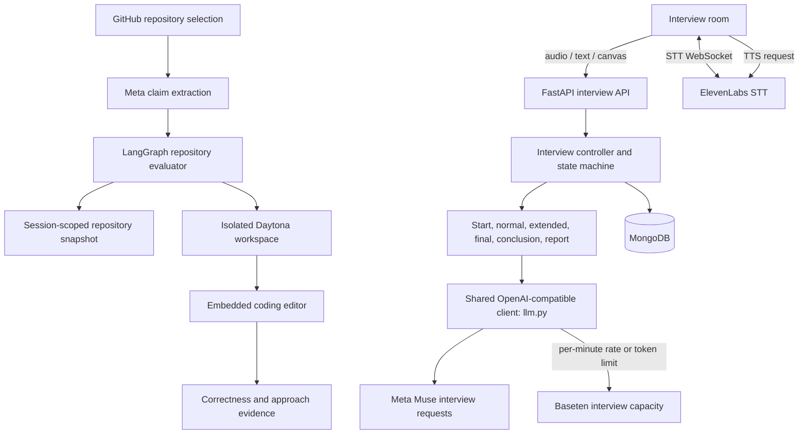
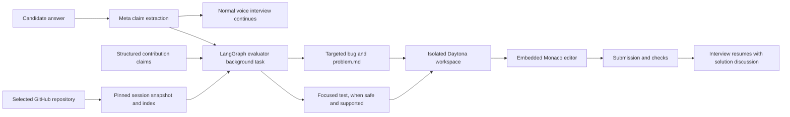

# Momentum: Adaptive AI Interview and Recruitment Platform

Momentum is my submission to the **Meta Global AI Developer Hackathon**, developed for Problem Statement 11 (PS11). It is a recruitment portal and adaptive voice interview platform: recruiters manage jobs and candidates, candidates apply and interview, and recruiters receive evidence-based evaluation reports. Meta Muse models are used for the competition's AI workflows, including interview reasoning and the repository evaluator, with work split across the live interview and background project analysis so repository preparation can happen while the conversation continues.

The central interview innovation is a **GitHub-backed project code review inside the interview**. Candidates explain what they personally built, then face a targeted change in the relevant part of their own repository. This supplements the previous adaptive interview experience with evidence from both the candidate's explanation and their work in an isolated editor.

## Platform capabilities

- Recruiter job creation and candidate application management.
- Candidate resume storage and interview setup from saved job/application data.
- Adaptive interview panel with 1–5 role-specific interviewer personas.
- Voice and typed answers, live transcript, ElevenLabs real-time speech-to-text and text-to-speech, and barge-in support.
- Server-authoritative interview timer and NORMAL, EXTENDED, FINAL, and CONCLUSION stages.
- Adaptive follow-up questions, panel turn selection, and an optional system-design canvas.
- Meta Muse and Baseten model capacity support interview generation and selected AI features. Interview requests are routed to preserve continuity when a provider reaches a per-minute token limit; repository claim extraction and challenge preparation use Meta Muse.
- MongoDB persistence for jobs, applications, interviewer sessions, candidate context, answers, events, canvas submissions, and evaluation reports. Job search reads and ranks job records directly from MongoDB.
- Job search tokenizes the query and ranks MongoDB job records by matches in titles, skills, and job details; no separate vector database or search service is required.
- Recruiter dashboards with candidate scores and hiring recommendations. Candidate-facing routes expose completion status rather than recruiter reports.

## What changed in the interview

The interview retains its dynamic panel structure: the AI builds a role-specific panel of **one to five distinct interviewer personas**, each with an interview stage, evaluation focus, reason for inclusion, and behavior. It assigns voices to the panel and selects an appropriate member to ask each question or deliver the closing. The number and specialties are generated for the role instead of requiring every interview to use the same fixed roster.

I also changed the interview flow to support project-based verification while preserving the regular interview:

1. **Project contribution intake:** When a candidate selected a GitHub repository, the opening project question asks about their role, personal implementation, approach, technologies, AI tools, and relevant components. Meta Muse extracts the answer into structured claims and asks a focused clarification if the explanation does not provide enough detail to analyze.
2. **Parallel preparation:** The normal voice interview proceeds while the repository evaluator analyzes the selected project in the background. The claims bound which parts of the repository are used to prepare the challenge.
3. **Adaptive interview decisions:** The existing NORMAL, EXTENDED, FINAL, and CONCLUSION stages continue to select questions and panel speakers based on the interview history and covered areas. When a repository challenge is ready, the normal-stage choices can also offer the code-editor assessment.
4. **Project code review:** The interviewer explains that a targeted bug was introduced in the claimed area and asks the candidate to fix it in the editor. A `problem.md` and focused test may be provided when the behavior can be safely tested. The workspace is isolated, and candidate changes are not pushed to GitHub.
5. **Return to conversation:** After submission, the editor workspace is cleaned up and the interview resumes with a discussion of the solution. The closing speech still completes before the regular interview report is generated.

This extends the previous panel interview rather than replacing it: the candidate is evaluated through their resume and verbal answers as before, with repository-specific evidence added when GitHub is connected and the isolated challenge is ready. See [Repository-backed interview coding challenge](#repository-backed-interview-coding-challenge) for the evaluator architecture and limits of its scoring evidence.

## Repository layout

```text
backend/
  main.py                    Unified FastAPI application
  routers/                   Recruitment portal endpoints
  interviewer/               Interview lifecycle, stages, prompts, Meta/Baseten LLM clients, voice, repo evaluator, and storage
  services/                  Recruitment AI, code execution, and search services
  candidate/                 Candidate resume analysis and problem generation
frontend/                    Next.js recruitment portal
frontend/interviewer/        Vite interview room
scripts/                     Migration, integration, and verification utilities
```

The root `start-dev.bat` starts the backend and portal frontend. The interview room is served from the backend at `/interview-app` when its built assets are present.

## LLM architecture

Interview prompts use one shared entry point: [`backend/interviewer/llm.py`](backend/interviewer/llm.py). Meta Muse and Baseten are configured as complementary model capacity for the interview experience. With both credentials present, the interview uses Meta Muse for normal requests and routes a request to Baseten when Meta reports a per-minute rate or token limit, helping the session continue through quota pressure. If only one provider is configured, that provider serves the interview. Recruitment AI features also use Baseten through [`backend/services/baseten_service.py`](backend/services/baseten_service.py), while repository claim extraction and challenge preparation use Meta Muse. Provider credentials stay on the backend and are never needed in the browser.

The model architecture does not own interview lifecycle logic. Existing stage prompts and validators still decide whether to continue, conclude, draw, or ask an advanced question; the controller still owns turn-taking, timers, persistence, and report visibility.



## Interview lifecycle

1. The controller reads the job and candidate context, prepares evaluation areas, and builds a tailored panel.
2. The configured interview provider creates the welcome and first question. The timer begins only after the client reports that the opening question audio has started.
3. After each answer, the current stage prompt generates the next decision and question. NORMAL can continue, conclude, or request a canvas exercise. EXTENDED raises question difficulty. FINAL allows one decisive question for exceptional performance, then ends.
4. A panel member delivers the closing message. The controller waits for speech completion before generating the report.
5. The structured report is stored for recruiters and linked to the application. Candidate-facing state returns completion status without the report.

The server remains authoritative for interview state and elapsed time. Voice capture and playback remain in the browser, with ElevenLabs credentials kept on the backend.

## Main backend modules

| Module | Responsibility |
|---|---|
| `backend/interviewer/interview_controller.py` | Interview state machine, timing, stage transitions, persistence, and events |
| `backend/interviewer/llm.py` | Shared Meta and Baseten OpenAI-compatible interview model routing |
| `backend/interviewer/prompts.py` | Panel, stage, closing, and report prompt templates |
| `backend/interviewer/normal_stage.py`, `extended_stage.py`, `final_stage.py` | Stage decisions and question generation |
| `backend/interviewer/stage_utils.py` | Output cleanup, JSON repair, and response validation |
| `backend/interviewer/canvas_analysis.py` | Canvas input validation and structured model vision result |
| `backend/interviewer/services/elevenlabs/` | Realtime STT relay and TTS synthesis |
| `backend/interviewer/tools/database/` | MongoDB configuration and persistence |
| `backend/interviewer/github_evaluator/` | Interview-scoped GitHub intake, LangGraph repository analysis, challenge preparation, Daytona workspace and submission evaluation |
| `frontend/interviewer/public/repo-evaluator/` | Embedded repository coding editor assets |
| `backend/routers/` | Recruitment portal API endpoints |

## Setup

### Requirements

- Python 3.12 recommended
- Node.js 18 or newer and npm
- MongoDB local or Atlas instance
- Meta Model API and Baseten credentials for competition AI workflows and interview capacity routing
- Daytona API key for isolated repository coding workspaces
- GitHub OAuth App credentials for repository connection
- ElevenLabs API key for interview voice features

### Install

```powershell
python -m venv backend\venv
backend\venv\Scripts\Activate.ps1
python -m pip install --upgrade pip
pip install -r backend\requirements.txt

cd frontend
npm install
cd ..
```

Create local environment files from the examples:

```powershell
Copy-Item backend\.env.example backend\.env
Copy-Item frontend\.env.example frontend\.env.local
```

Configure model, repository, and voice credentials in `backend/.env` (names below; keep the actual values private):

```dotenv
MODEL_API_KEY=your-meta-model-api-key
META_API_BASE_URL=https://api.meta.ai/v1
META_API_MODEL=muse-spark-1.3
BASETEN_API_KEY=your-baseten-api-key
BASETEN_BASE_URL=https://inference.baseten.co/v1
BASETEN_MODEL=meta-models/muse-spark-open-1026
BASETEN_MAX_OUTPUT_TOKENS=2048
DAYTONA_API_KEY=your-daytona-api-key
GITHUB_CLIENT_ID=your-github-oauth-client-id
GITHUB_CLIENT_SECRET=your-github-oauth-client-secret
GITHUB_CALLBACK_URL=http://localhost:8000/auth/github/callback
```

Fill in the other backend values required by the features you use. Do not commit real credentials. Keep model provider credentials in `backend/.env`; frontend environment files should contain only public configuration such as the backend URL.

### Configuration reference

| Variable | Used by | Purpose |
|---|---|---|
| `BASETEN_API_KEY` | Backend | Baseten API key for text and vision model calls |
| `MODEL_API_KEY` (also `META_API_KEY`, `META_AI_API_KEY`) | Backend | Meta Model API key; primary interview and repository evaluator provider |
| `META_API_BASE_URL` | Backend | Meta OpenAI-compatible API base URL |
| `META_API_MODEL` | Backend | Meta model name |
| `BASETEN_BASE_URL` | Backend | OpenAI-compatible endpoint; defaults to `https://inference.baseten.co/v1` |
| `BASETEN_MODEL` | Backend | Baseten model; defaults to `meta-models/muse-spark-open-1026` |
| `BASETEN_MAX_OUTPUT_TOKENS` | Backend | Interview model response limit |
| `BASETEN_REASONING_EFFORT` | Backend | Muse Spark reasoning budget; defaults to `low` for responsive interview turns |
| `GITHUB_CLIENT_ID` / `GITHUB_CLIENT_SECRET` | Backend | GitHub App OAuth credentials; never put these in frontend env files |
| `GITHUB_CALLBACK_URL` | Backend | Must exactly match the GitHub App callback URL |
| `GITHUB_FRONTEND_ORIGINS` | Backend | Allowlisted interview app origins used after GitHub authorization |
| `DAYTONA_API_KEY` | Backend | Creates isolated remote workspaces for repository challenges |
| `REPO_EVALUATOR_DATABASE_PATH` | Backend | Path to the evaluator's session database; defaults under `backend/data/` |
| `REPO_EVALUATOR_MONGODB_DATABASE` | Backend | MongoDB database used for evaluator session/index data |
| `ELEVENLABS_API_KEY` | Backend | ElevenLabs STT and TTS |
| `ELEVENLABS_STT_MODEL` | Backend | STT model; defaults to `scribe_v2_realtime` |
| `ELEVENLABS_TTS_MODEL` | Backend | TTS model; defaults to `eleven_flash_v2_5` |
| `MONGODB_URI` | Backend | MongoDB connection URI |
| `MONGODB_DATABASE` / `DB_NAME` | Backend | Database name |
| `HOST`, `PORT` | Backend | FastAPI bind address and port |
| `NEXT_PUBLIC_API_URL` | Frontend | FastAPI base URL, normally `http://127.0.0.1:8000` |
Keep all provider, GitHub, Daytona, ElevenLabs, and database credentials in `backend/.env`, never in frontend environment files. Install `backend/requirements.txt` to include the Daytona SDK and evaluator dependencies.

The interview setup page can connect GitHub and select a repository mentioned in the candidate's resume. Selecting a repository alone does not begin source analysis. After the candidate describes their contribution, the evaluator fetches a pinned repository snapshot for that interview session. See the repository coding challenge section below for data handling and the full flow.

### Run

Windows can use the root launcher:

```bat
start-dev.bat
```

Or start each service in a separate terminal:

```bash
npm run dev:backend
npm run dev:frontend
```

## API surface

The unified FastAPI app exposes the recruitment routers and interview endpoints, including:

| Method | Route | Purpose |
|---|---|---|
| `GET` | `/api/health` | Backend health check |
| `GET` | `/api/interview/setup-data` | Load interview setup context |
| `POST` | `/api/interviews` | Create an interview |
| `GET` | `/api/interviews/{id}` | Read public interview state |
| `POST` | `/api/interviews/{id}/answer` | Submit a typed or transcribed answer |
| `POST` | `/api/interviews/{id}/question-started` | Start the authoritative timer |
| `POST` | `/api/interviews/{id}/speech-finished` | Mark closing speech complete and generate report |
| `POST` | `/api/interviews/{id}/canvas` | Submit a canvas image for analysis |
| `WS` | `/api/interviews/{id}/events` | Live interview events and transcript |
| `WS` | `/api/interviews/{id}/stt` | Realtime microphone transcription |

OpenAPI documentation is available at `http://127.0.0.1:8000/docs`.

## Verification scripts

The repository includes integration and feature checks under `scripts/`, plus root-level verification scripts. Run the relevant script with the backend virtual environment after configuring its required services and test data. These scripts may write test records to the configured database.

## Access points

| Service | Local URL |
|---|---|
| Recruitment portal | `http://localhost:3000` |
| Recruiter candidates dashboard | `http://localhost:3000/recruiter/dashboard/candidates` |
| Interview room | `http://127.0.0.1:8000/interview-app` |
| FastAPI docs | `http://127.0.0.1:8000/docs` |
## Repository-backed interview coding challenge

Candidates may connect GitHub and select the repository they described in their resume. The first repository-specific interview question asks what the candidate did, their role, implementation details, technologies and AI tools used, and relevant files or components. Meta converts the answer into structured claims. If the account of the work is unclear, the interviewer asks for clarification before starting repository preparation.

The evaluator uses those claims to bound its investigation. Its LangGraph workflow fetches and indexes the selected repository at a pinned revision, analyzes the claimed area, and prepares a targeted bug-fix challenge in the background while the normal voice interview continues. Where the behavior can be checked safely, it creates a focused test file alongside `problem.md`. When the isolated Daytona workspace is ready, the interviewer offers the editor exercise as an additional interview action. The candidate can inspect the problem, edit the temporary checkout, and run the provided focused test when available. The candidate's changes are not pushed to GitHub. After submission, the workspace is removed and the voice interview resumes with a discussion of the solution.

The coding result provides evidence about the candidate's claimed contribution: the evaluator can compare the submitted change with the regression, run supported checks, and, for supported Python challenges, compare the solution's implementation approach. The verbal interview also continues to assess the candidate's explanations. These signals can help identify mismatches between a claim and demonstrated understanding, and can recognize work beyond a minimal fix. A single result is evidence for interview review, not proof that a candidate lied or a guarantee of a particular hiring outcome. The code exercise is not currently folded into a single numeric recruiter score.

### Evaluator architecture and session data



Each interview receives its own assessment and candidate IDs. Evaluator session metadata is kept in its configured SQLite database, separate from the portal's interview database; repository indexing/challenge records use the configured evaluator MongoDB database. The GitHub access token is encrypted in the evaluator store and cleared after repository preparation. The fetched snapshot and temporary workspace are session-scoped and cleaned up after submission or expiry. Assessment metadata/results and candidate submission records may be retained for the session evaluation; this is not a promise that every evaluation record is immediately erased.

Configure `MODEL_API_KEY` in `backend/.env` for Meta, `DAYTONA_API_KEY` for isolated workspaces, and the GitHub OAuth values listed above. Install the evaluator dependencies from `backend/requirements.txt`. If evaluator prerequisites or a safe challenge are unavailable, the editor action is not offered; the normal interview can continue. The evaluator's optional hint assistant uses Baseten credentials.
