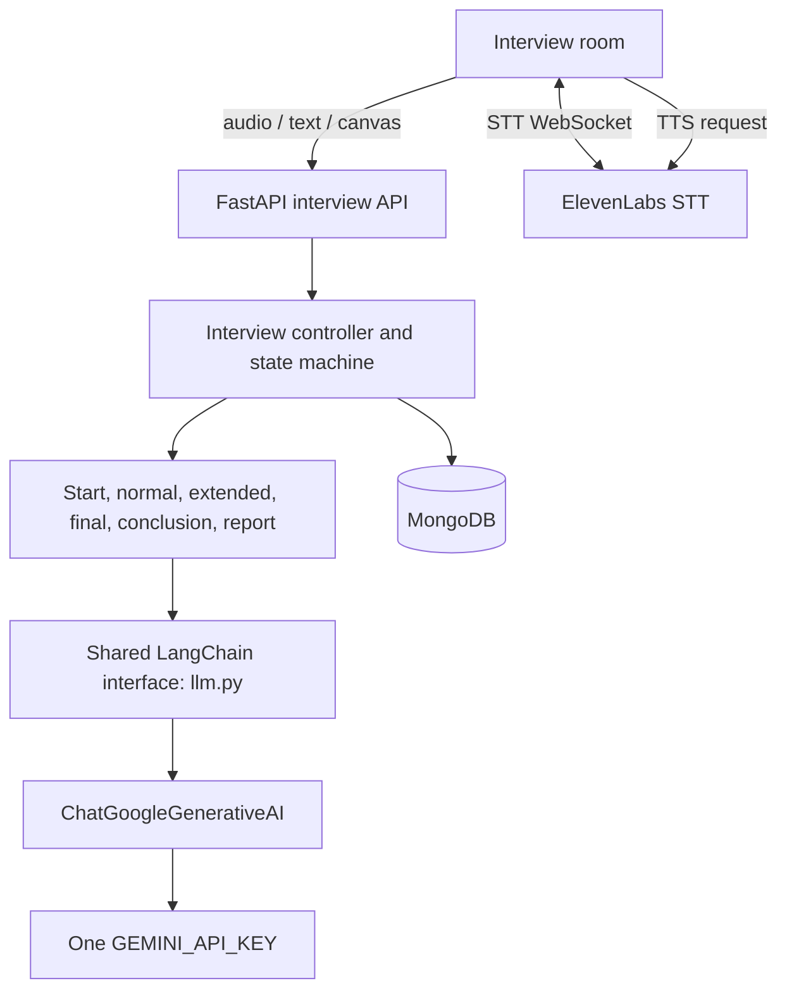

# Momentum: Adaptive AI Interview and Recruitment Platform

Momentum is a recruitment portal and adaptive voice interview platform developed for Problem Statement 11 (PS11). Recruiters manage jobs and candidates, candidates apply and interview, and recruiters receive evidence-based evaluation reports.

## Platform capabilities

- Recruiter job creation and candidate application management.
- Candidate resume storage and interview setup from saved job/application data.
- Adaptive interview panel with 1–5 role-specific interviewer personas.
- Voice and typed answers, live transcript, ElevenLabs real-time speech-to-text and text-to-speech, and barge-in support.
- Server-authoritative interview timer and NORMAL, EXTENDED, FINAL, and CONCLUSION stages.
- Adaptive follow-up questions, panel turn selection, and an optional system-design canvas.
- Gemini-generated panel, questions, closing message, canvas analysis, and recruiter evaluation report.
- MongoDB persistence for jobs, applications, interviewer sessions, candidate context, answers, events, canvas submissions, and evaluation reports. Job search reads and ranks job records directly from MongoDB.
- Job search tokenizes the query and ranks MongoDB job records by matches in titles, skills, and job details; no separate vector database or search service is required.
- Recruiter dashboards with candidate scores and hiring recommendations. Candidate-facing routes expose completion status rather than recruiter reports.

## Repository layout

```text
backend/
  main.py                    Unified FastAPI application
  routers/                   Recruitment portal endpoints
  interviewer/               Interview lifecycle, stages, prompts, Gemini chain, voice, and storage
  services/                  Recruitment AI, code execution, and search services
  candidate/                 Candidate resume analysis and problem generation
frontend/                    Next.js recruitment portal
frontend/interviewer/        Vite interview room
scripts/                     Migration, integration, and verification utilities
```

The root `start-dev.bat` starts the backend and portal frontend. The interview room is served from the backend at `/interview-app` when its built assets are present.

## LLM architecture

Interview prompts use one shared LangChain entry point: [`backend/interviewer/llm.py`](backend/interviewer/llm.py). It constructs a LangChain Expression Language (LCEL) chain from a prompt-to-message runnable, `ChatGoogleGenerativeAI`, and `StrOutputParser`. All interview stages and supporting candidate analysis use the same `ask_llm` interface. Canvas images use the same Gemini model integration through LangChain's multimodal message format.

There is one backend Gemini credential, `GEMINI_API_KEY`. No Groq provider, provider router, numbered key pool, token-threshold routing, or key rotation is used. `GEMINI_MODEL` selects the Gemini model (default `gemini-2.5-flash`). `GEMINI_MAX_OUTPUT_TOKENS` controls the default response limit.

The model architecture does not own interview lifecycle logic. Existing stage prompts and validators still decide whether to continue, conclude, draw, or ask an advanced question; the controller still owns turn-taking, timers, persistence, and report visibility.



## Interview lifecycle

1. The controller reads the job and candidate context, prepares evaluation areas, and builds a tailored panel.
2. Gemini creates the welcome and first question. The timer begins only after the client reports that the opening question audio has started.
3. After each answer, the current stage prompt generates the next decision and question. NORMAL can continue, conclude, or request a canvas exercise. EXTENDED raises question difficulty. FINAL allows one decisive question for exceptional performance, then ends.
4. A panel member delivers the closing message. The controller waits for speech completion before generating the report.
5. The structured report is stored for recruiters and linked to the application. Candidate-facing state returns completion status without the report.

The server remains authoritative for interview state and elapsed time. Voice capture and playback remain in the browser, with ElevenLabs credentials kept on the backend.

## Main backend modules

| Module | Responsibility |
|---|---|
| `backend/interviewer/interview_controller.py` | Interview state machine, timing, stage transitions, persistence, and events |
| `backend/interviewer/llm.py` | Shared LangChain Gemini text and image generation |
| `backend/interviewer/prompts.py` | Panel, stage, closing, and report prompt templates |
| `backend/interviewer/normal_stage.py`, `extended_stage.py`, `final_stage.py` | Stage decisions and question generation |
| `backend/interviewer/stage_utils.py` | Output cleanup, JSON repair, and response validation |
| `backend/interviewer/canvas_analysis.py` | Canvas input validation and structured Gemini vision result |
| `backend/interviewer/services/elevenlabs/` | Realtime STT relay and TTS synthesis |
| `backend/interviewer/tools/database/` | MongoDB configuration and persistence |
| `backend/routers/` | Recruitment portal API endpoints |

## Setup

### Requirements

- Python 3.12 recommended
- Node.js 18 or newer and npm
- MongoDB local or Atlas instance
- Gemini API key for AI generation
- ElevenLabs API key for interview voice features

### Install

```powershell
python -m venv backend\venv
backend\venv\Scripts\Activate.ps1
python -m pip install --upgrade pip
pip install -r backend\requirements.txt

cd frontend
npm install
cd ..
```

Create local environment files from the examples:

```powershell
Copy-Item backend\.env.example backend\.env
Copy-Item frontend\.env.example frontend\.env.local
```

Set the single backend Gemini key in `backend/.env`:

```dotenv
GEMINI_API_KEY=your-gemini-api-key
GEMINI_MODEL=gemini-2.5-flash
GEMINI_MAX_OUTPUT_TOKENS=2048
```

Fill in the other backend values required by the features you use. Do not commit real credentials. The frontend example includes a Gemini variable for existing client-side recruitment AI features; use the same Google AI Studio key if those features are enabled.

### Configuration reference

| Variable | Used by | Purpose |
|---|---|---|
| `GEMINI_API_KEY` | Backend | Single Gemini API key used by LangChain model calls |
| `GEMINI_MODEL` | Backend | Gemini model name; defaults to `gemini-2.5-flash` |
| `GEMINI_MAX_OUTPUT_TOKENS` | Backend | Default generated response token limit |
| `ELEVENLABS_API_KEY` | Backend | ElevenLabs STT and TTS |
| `ELEVENLABS_STT_MODEL` | Backend | STT model; defaults to `scribe_v2_realtime` |
| `ELEVENLABS_TTS_MODEL` | Backend | TTS model; defaults to `eleven_flash_v2_5` |
| `MONGODB_URI` | Backend | MongoDB connection URI |
| `MONGODB_DATABASE` / `DB_NAME` | Backend | Database name |
| `HOST`, `PORT` | Backend | FastAPI bind address and port |
| `NEXT_PUBLIC_API_URL` | Frontend | FastAPI base URL, normally `http://127.0.0.1:8000` |
| `GEMINI_API_KEY` | Frontend | Existing recruitment-side Gemini features; configure only if those client features are enabled |

The interview room uses the backend Gemini key. The ElevenLabs key and database credentials belong in the backend environment file.

### Run

Windows can use the root launcher:

```bat
start-dev.bat
```

Or start each service in a separate terminal:

```bash
npm run dev:backend
npm run dev:frontend
```

## API surface

The unified FastAPI app exposes the recruitment routers and interview endpoints, including:

| Method | Route | Purpose |
|---|---|---|
| `GET` | `/api/health` | Backend health check |
| `GET` | `/api/interview/setup-data` | Load interview setup context |
| `POST` | `/api/interviews` | Create an interview |
| `GET` | `/api/interviews/{id}` | Read public interview state |
| `POST` | `/api/interviews/{id}/answer` | Submit a typed or transcribed answer |
| `POST` | `/api/interviews/{id}/question-started` | Start the authoritative timer |
| `POST` | `/api/interviews/{id}/speech-finished` | Mark closing speech complete and generate report |
| `POST` | `/api/interviews/{id}/canvas` | Submit a canvas image for analysis |
| `WS` | `/api/interviews/{id}/events` | Live interview events and transcript |
| `WS` | `/api/interviews/{id}/stt` | Realtime microphone transcription |

OpenAPI documentation is available at `http://127.0.0.1:8000/docs`.

## Verification scripts

The repository includes integration and feature checks under `scripts/`, plus root-level verification scripts. Run the relevant script with the backend virtual environment after configuring its required services and test data. These scripts may write test records to the configured database.

## Access points

| Service | Local URL |
|---|---|
| Recruitment portal | `http://localhost:3000` |
| Recruiter candidates dashboard | `http://localhost:3000/recruiter/dashboard/candidates` |
| Interview room | `http://127.0.0.1:8000/interview-app` |
| FastAPI docs | `http://127.0.0.1:8000/docs` |
