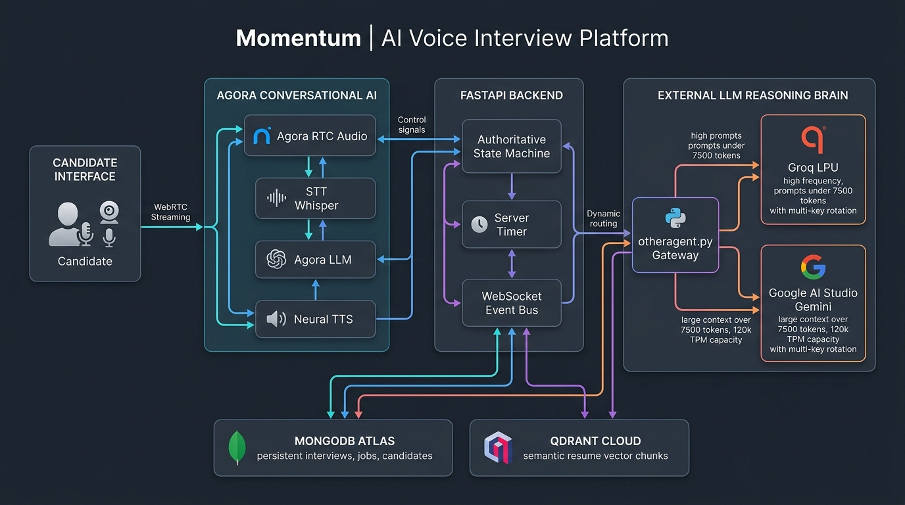
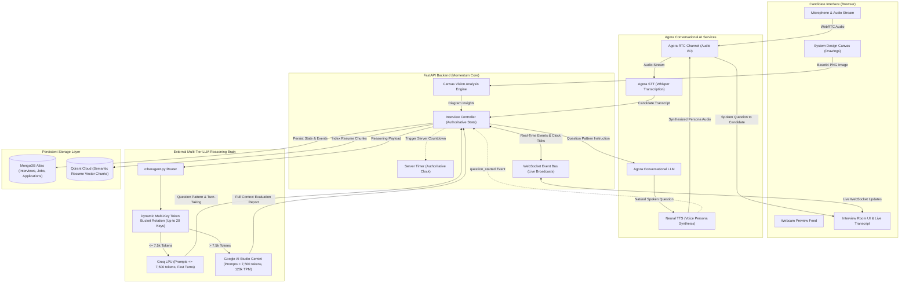

# Momentum: Adaptive Multi-Agent AI Voice Interview & Recruitment Platform
### Developed for the EchoSphere Competition - Problem Statement 11 (PS11)

---

## Table of Contents
1. [Platform Vision and Overview](#1-platform-vision-and-overview)
2. [Direct Alignment with Problem Statement 11 (PS11)](#2-direct-alignment-with-problem-statement-11-ps11)
   - [PS11 Requirements Compliance Matrix](#ps11-requirements-compliance-matrix)
   - [Dynamic Panel Generation: 1 to 5 Roles](#dynamic-panel-generation-1-to-5-roles)
   - [Walkthrough: The Example Multi-Role Scenario](#walkthrough-the-example-multi-role-scenario)
3. [System Architecture and Working Theory](#3-system-architecture-and-working-theory)
   - [System Architecture Diagram (Visual)](#system-architecture-diagram-visual)
   - [System Architecture Flow (Mermaid)](#system-architecture-flow-mermaid)
   - [Dual-LLM Strategy: Agora-Supported Voice LLM and External Reasoning Brain](#dual-llm-strategy-agora-supported-voice-llm-and-external-reasoning-brain)
   - [Multi-Tier External LLM Hierarchy: Groq and Google AI Studio](#multi-tier-external-llm-hierarchy-groq-and-google-ai-studio)
   - [Decision Latency Analysis and Production Scaling](#decision-latency-analysis-and-production-scaling)
   - [Authoritative Server-Side Timer Architecture](#authoritative-server-side-timer-architecture)
   - [Adaptive Interview Lifecycle Stages](#adaptive-interview-lifecycle-stages)
   - [Interactive System Design Canvas with Vision Analysis](#interactive-system-design-canvas-with-vision-analysis)
4. [Core Engine Modules and Key Packages](#4-core-engine-modules-and-key-packages)
   - [Core Functional Engines](#core-functional-engines)
   - [Primary Software Packages and SDKs](#primary-software-packages-and-sdks)
5. [The Momentum Recruitment Platform (In Short)](#5-the-momentum-recruitment-platform-in-short)
6. [Setup and Installation Guide](#6-setup-and-installation-guide)
   - [Prerequisites and System Requirements](#prerequisites-and-system-requirements)
   - [Step-by-Step Installation](#step-by-step-installation)
   - [Environment Variables Reference](#environment-variables-reference)
   - [Running the Platform](#running-the-platform)
   - [Automated Verification Suite](#automated-verification-suite)
   - [System Access Points](#system-access-points)
7. [License](#7-license)

---

## 1. Platform Vision and Overview

**Momentum** is an autonomous recruitment platform and adaptive multi-agent AI voice interview system developed for the **EchoSphere** competition. Rather than forcing candidates through a static questionnaire or robotic form-filling, our platform deploys a coordinated panel of distinct, specialized AI interviewers who listen, converse, evaluate, and challenge candidates in real time.

Our portal unifies the entire hiring pipeline:
- **Recruiters** post technical job openings, define required skills, experience levels, and evaluation parameters.
- **Candidates** browse open positions and submit applications using their stored resume profile with one click.
- **Zero-Friction Interview Bridge**: When a candidate initiates an interview, our portal automatically extracts the candidate's resume and job requirements from the database into the interview room without requiring manual re-uploading or form-filling.
- **Adaptive Multi-Agent Interview**: An AI panel conducts an interactive voice interview featuring real-time turn-taking, follow-up probing, system design sketching, and dynamic difficulty scaling.
- **Automated Result Declaration**: Upon completion, a comprehensive evaluation report with granular metrics (match percentage, technical skills, communication, problem-solving) automatically feeds into the recruiter candidate leaderboard, sorted strictly by score for streamlined hiring decisions.

The interview engine is completely dedicated to real-time conversational adaptability, multi-role turn-taking, and deep cognitive reasoning.

---

## 2. Direct Alignment with Problem Statement 11 (PS11)

### Problem Statement Definition
> **PS11**: Build an adaptive voice interview platform in which one or more AI interviewers represent different roles. The interview panel may include a technical interviewer, hiring manager, customer, product manager or behavioural interviewer. The system should adapt its questions based on the candidate's previous answers rather than following only a predefined question list.

---

### PS11 Requirements Compliance Matrix

| PS11 Requirement | How Momentum (Our System) Implements It |
|---|---|
| **1. Real-Time & Interruptible Voice Interviews** | Powered by **Agora RTC** and **Agora Conversational AI**. Candidate speech is streamed bidirectionally over an ultra-low-latency WebRTC audio channel. The speech detection pipeline detects when a candidate begins speaking, instantly pausing TTS playback and yielding the floor without unnatural delays. |
| **2. Multiple Interviewer Roles & Personalities** | Our panel generator dynamically composes an interview committee of 1 to 5 members tailored to the job requirements and candidate profile. Potential roles include **Technical Interviewer**, **Senior Software Engineer**, **Product Manager**, **Engineering Manager**, **Customer Advocate**, and **HR Manager**, each with distinct personalities, behavioral rules, and neural voice profiles. |
| **3. Shared Candidate Context Between Roles** | A centralized server-side state machine maintains complete session memory. Every question asked, candidate answer, resume section, and evaluation metric is stored in a shared context. When one interviewer hands off to another, the incoming interviewer possesses full awareness of everything discussed previously. |
| **4. Dynamic Follow-Up Questions** | Our system does not follow a predefined question list. After every candidate response, our reasoning brain evaluates the substance of the answer against the candidate's resume and job requirements, choosing whether to probe deeper into technical trade-offs, explore project claims, or change directions. |
| **5. Controlled Interviewer Turn-Taking** | After each response, our reasoning engine determines which panel member should speak next based on their domain expertise and the topic being probed. The system passes the virtual floor seamlessly, ensuring natural committee conversation without overlapping voices. |
| **6. Role-Play & Scenario-Based Questions** | Panel members pose contextual scenarios (e.g., handling production outages, designing scalable architectures, balancing business impact with engineering speed, and addressing customer needs). The system also features an interactive System Design Canvas for real-time architecture diagrams. |
| **7. Difficulty Adjustment Based on Performance** | Structured three-stage progression: **Normal Stage** (core competencies and project validation) -> **Extended Stage** (deeper questions probing trade-offs, edge cases, failure recovery, and architectural scalability) -> **Final Stage** (strictly one decisive, high-complexity question for top candidates). |
| **8. Identification of Vague or Contradictory Answers** | Our reasoning engine analyzes candidate responses against known engineering principles and previously stated claims. If an answer lacks concrete implementation details, contradicts an earlier response, or dodges a key requirement, the panel generates targeted follow-up prompts to address the gap. |
| **9. Evidence-Based Feedback Linked to Transcript** | The post-interview evaluation report synthesizes exact quotes, timestamps, and question-answer pairs directly from the transcript, providing objective evidence for strengths, concerns, hire reasons, and reject reasons. |
| **10. Structured Final Assessment** | Generates a validated multi-dimensional scorecard: overall match percentage, job role match, skills match, experience match, qualification match, technical score, communication score, problem-solving score, and an actionable hiring recommendation (`Strong Hire`, `Hire`, `Consider`, `Do Not Hire`). |
| **11. Clear Disclosure of AI Interaction** | Our portal explicitly discloses that the interview is conducted by an autonomous AI panel. Disclosures are prominently displayed in the pre-flight device lobby, atop the live interview room header, and acknowledged in the opening welcome statement. |

---

### Dynamic Panel Generation: 1 to 5 Roles

Our panel composition is **100% dynamic and adaptive**—nothing is hardcoded or static. When an interview is initialized, our reasoning brain analyzes the company background, role title, required skills, and candidate seniority to determine the optimal panel size (from **1 up to 5 members**) and their distinct responsibilities.

#### Concrete Dynamic Example: 3-Member Panel for a Full-Stack Product Engineer
When evaluating a Full-Stack Product Engineer position, our system dynamically instantiates a 3-member panel:
1. **Juhi (HR & Behavioral Manager)**:
   - **Focus**: Evaluates communication, work ethics, culture fit, and teamwork.
   - **Persona**: Warm, professional, and perceptive.
   - **Behavior**: Asks structured behavioral questions and assesses how the candidate collaborates with cross-functional teams.
2. **Dhruv (Lead Technical Interviewer / Senior Software Engineer)**:
   - **Focus**: Evaluates technical depth, Python/FastAPI backend architecture, caching, database indexing, and scalability.
   - **Persona**: Analytical, deep, authoritative, and methodical.
   - **Behavior**: Probes technical claims made on the resume and challenges algorithmic and architectural choices.
3. **Neha (Product Manager / Engineering Manager)**:
   - **Focus**: Evaluates user empathy, business metrics, feature trade-offs, and customer impact.
   - **Persona**: Energetic, structured, pragmatic, and outcome-focused.
   - **Behavior**: Challenges candidates to justify engineering complexity against customer value and delivery timelines.

#### Dynamic Adaptation for Other Roles
- **DevOps / Infrastructure Engineer**: Our system might dynamically select a 2-member panel: an Infrastructure Architect and a Site Reliability Engineer.
- **Enterprise / Engineering Leadership**: Our system can dynamically scale up to 4 or 5 members, introducing a Customer Success Lead, a Security Architect, and a VP of Engineering.

Each panel member receives a distinct role, seniority level, evaluation focus, behavioral guidelines, and an assigned neural voice from our voice catalog.

---

### Walkthrough: The Example Multi-Role Scenario

**Problem Statement Scenario:**
> *"A candidate provides a technically correct solution but does not explain its impact on customers. The technical interviewer may accept the implementation, while the product interviewer should challenge the candidate to explain the business implications."*

**How Our System Handles This Scenario at Runtime:**

1. **Step 1: Technical Interviewer Probes Architecture**
   - **Dhruv (Lead Technical Interviewer)** asks:
     `"How would you design a caching layer to handle a 10x traffic spike on our payment service?"`
   - **Candidate Answer**:
     `"I would introduce Redis clusters with a write-through caching strategy and set up LRU eviction with a 5-minute TTL to keep hot data in memory."`

2. **Step 2: Reasoning Brain Evaluates Response**
   - Our reasoning engine reviews the transcript.
   - Evaluation: The technical implementation (Redis cluster, write-through, LRU, TTL) is sound. However, the candidate failed to consider customer experience during checkout, potential data inconsistencies, or duplicate billing scenarios.

3. **Step 3: Controlled Turn-Taking to Product Manager Persona**
   - The reasoning brain switches speakers from the Technical Interviewer to the Product Manager persona (**Neha**).
   - Our reasoning engine formulates a targeted internal question pattern:
     `"Candidate gave a sound technical Redis caching setup, but ignored customer transaction consistency and payment checkout impact. Challenge them on user-facing implications during cache inconsistencies."`

4. **Step 4: Natural Question Generation and Delivery**
   - Agora Conversational AI's LLM transforms the pattern into a conversational challenge:
     `"That caching setup handles the load well technically, Dhruv. But looking at this from our customers' perspective: if a user makes a payment and sees an outdated balance because of that 5-minute cache delay, they might panic and submit a duplicate charge. How would you design this so customers never experience inconsistent transaction states?"`
   - Agora TTS synthesizes the audio using Neha's distinct persona voice.

5. **Step 5: Assessment Integration**
   - The candidate's subsequent explanation is recorded in the transcript. If the candidate adapts, they gain points under `problem_solving_score` and `communication_score`; if they dismiss the customer impact, this is cited as a specific concern in the final report under `concerns` with direct transcript evidence.

---

## 3. System Architecture and Working Theory

### System Architecture Diagram (Visual)



---

### System Architecture Flow (Mermaid)



---

### Dual-LLM Strategy: Agora-Supported Voice LLM and External Reasoning Brain

A critical architectural distinction in our system is the coordinated use of **both Agora-supported LLMs and External LLMs**:

1. **Agora Conversational AI LLM (Voice-Facing)**:
   - Base models out-of-the-box in voice systems lack the entropy, memory capacity, and domain reasoning necessary to act as an autonomous interview committee.
   - In our system, the Agora-supported LLM is utilized exclusively for **conversational naturalization**: it takes our high-level question instruction and turns it into natural, second-person spoken speech, free of internal meta-evaluations.

2. **External Reasoning Brain (Cognitive Control)**:
   - Our external LLM layer handles all reasoning, candidate evaluation, turn-taking, topic direction, difficulty scaling, and comprehensive report generation.
   - **Groq does NOT speak directly to the candidate during iterative stages.** Groq outputs a concise *question pattern*. Agora Conversational AI's LLM formulates the actual question, and Agora TTS speaks it.

---

### Multi-Tier External LLM Hierarchy: Groq and Google AI Studio

To power our external reasoning brain robustly, our portal integrates two complementary LLM providers: **Groq** and **Google AI Studio (Gemini)**.

#### Why Dual Providers?
- **Google AI Studio (Gemini)**: Provides massive per-minute token throughput (over 120,000 tokens per minute) and a vast context window, but enforces strict daily request caps. This makes it ideal for processing complete multi-page candidate resumes, full interview histories, and exhaustive evaluation report generation.
- **Groq**: Delivers ultra-low-latency LPU inference for real-time conversational turns, but restricts free-tier throughput to approximately 8,000 tokens per minute.

#### Dynamic Routing via `otheragent.py`
The top-level gateway (`otheragent.py`) estimates the input prompt token count before dispatching:
- **Prompts <= 7,500 tokens**: Automatically routed to **Groq** for sub-second reasoning and turn-taking.
- **Prompts > 7,500 tokens**: Automatically routed to **Google AI Studio (Gemini)** for deep contextual analysis and report compilation.

#### Multi-Key Token Bucket Rotation
Inside the routing layer (`groqrouter.py` and `geminirouter.py`), our system loads up to 20 API keys from the environment. The system dynamically maintains:
- Per-minute token bucket tracking
- Active request counts
- Daily quota consumption
This rotation mechanism balances requests across keys, preventing rate-limit blocks and ensuring reliable, uninterrupted interviews.

---

### Decision Latency Analysis and Production Scaling

During live interviews, evaluators may observe a reasoning decision latency averaging approximately 1.5 to 2.0 seconds between the end of candidate speech and the generation of the next question pattern.

**Root Cause**:
This latency is primarily an artifact of using free-tier API accounts:
1. Programmatic overhead of verifying token buckets across multiple keys.
2. Checking rate-limit states before each request.
3. Sequential fallback handling when an individual key reaches its per-minute quota.

**Production Scaling Path**:
In an enterprise deployment with dedicated or paid tier API access:
- Key rotation and quota-checking overhead would be completely eliminated.
- Direct streaming from dedicated Groq LPU endpoints would reduce the reasoning cycle to **0.5 to 1.0 second**, enabling near-instantaneous committee turn-taking.

---

### Authoritative Server-Side Timer Architecture

To maintain strict evaluation integrity and prevent client-side clock tampering:
- **The timer does NOT start** on "Start Interview" button click.
- **The timer does NOT start** during resume parsing or panel generation.
- **The timer does NOT start** when the opening greeting is formulated.
- **The timer STARTS ONLY** when Agora emits the `question_started` event indicating that the first interview question is actively being spoken.

The backend maintains the authoritative start timestamp and broadcasts countdown ticks over WebSockets. If the candidate refreshes the page, the timer remains strictly synchronized to the server clock.

---

### Adaptive Interview Lifecycle Stages

```text
[ START STAGE ]
       |
       | Opening question spoken -> question_started event
       v
[ NORMAL STAGE ] (Elapsed < Base Time, default 30 min)
       |
       +---> Candidate answers via mic or text
       +---> Groq evaluates: CONTINUE, CONCLUDE, or DRAW
       |       * CONTINUE -> Topic direction, question pattern, panel member, Agora LLM, TTS
       |       * DRAW     -> System Design Canvas question
       |       * CONCLUDE -> Early conclusion if candidate answers prove completely inadequate
       v
[ EXTENDED STAGE ] (Base Time <= Elapsed < Extended Time, default 45 min)
       |
       +---> Deeper questions probing architecture, scalability, edge cases, and trade-offs
       +---> Performance evaluation decides whether to continue or conclude
       v
[ FINAL STAGE ] (Elapsed >= Extended Time)
       |
       +---> Groq decides CONCLUDE or permits strictly ONE final question
       +---> If final question asked -> Candidate answers -> FORCED CONCLUSION
       v
[ CONCLUSION STAGE ]
       |
       +---> Closing remarks thanking candidate delivered by selected panel member
       +---> System strictly WAITS for Agora speech_completed event
       v
[ EVALUATION REPORT STAGE ]
       |
       +---> Full transcript, answers, and canvas diagrams evaluated against job criteria
       +---> Validated JSON report persisted to MongoDB and linked to application
```

#### 1. Start Stage
Our system analyzes the job description and candidate resume to formulate an opening greeting and initial question, assigning it to an opening panel member (e.g., HR Manager). The authoritative timer starts upon speech delivery.

#### 2. Normal Stage
Active while `elapsed_time < base_time` (default 30 minutes). Operates in an adaptive loop: candidate responds -> Agora STT transcribes -> Reasoning brain decides whether to continue, conclude, or trigger a system design drawing.

#### 3. Extended Stage
Active while `base_time <= elapsed_time < extended_time` (default 45 minutes). The interview increases in rigor, probing production debugging, distributed system trade-offs, and failure recovery.

#### 4. Final Stage
Active once extended time is reached. The reasoning engine permits **strictly ONE final question** for top performers. Once answered, the interview concludes unconditionally.

#### 5. Conclusion Stage
Our system generates a closing message. The closing panel member delivers it via Agora TTS. The system waits for Agora's `speech_completed` event before generating the final report.

#### 6. Evaluation Report Stage
Compiles a structured scorecard with numeric scores (0–100) across technical depth, communication, and problem-solving, supported by direct transcript quotes and an explicit recommendation (`Strong Hire`, `Hire`, `Consider`, `Do Not Hire`).

---

### Interactive System Design Canvas with Vision Analysis

Momentum incorporates an interactive architectural sketch pad for technical evaluations:
- When a system design question is triggered, the candidate interface presents a drawing canvas equipped with pen tools, shapes, and labels.
- The candidate sketches their architectural topology (e.g., microservices, load balancers, database caches, message queues).
- Upon submission, the drawing is sent as a base64 PNG image to our backend.
- Our vision analysis engine evaluates structural components, connectivity, data flow bottlenecks, single points of failure, and scalability.
- The resulting analysis is factored into the interview state and final scorecard.

---

## 4. Core Engine Modules and Key Packages

### Core Functional Engines

| Engine Component | Primary Capability & Responsibility |
|---|---|
| **Authoritative State Controller** | Coordinates the interview state machine, enforces stage transitions, guarantees server timer authority, manages turn-taking lifecycles, and broadcasts real-time events over WebSockets. |
| **Cognitive Reasoning Gateway** | The single AI entry point. Manages multi-key rotation across Groq and Google AI Studio keys, calculates token counts, routes workloads dynamically based on token limits, and handles sequential fallbacks. |
| **Dynamic Panel Generator** | Evaluates the job description and candidate profile to construct a tailored interview panel of 1 to 5 fictional personas with distinct roles, seniorities, evaluation criteria, and behavioral rules. |
| **Voice Catalog & Persona Mapper** | Maps panel members to distinct neural voices with specific genders, accents (American, British, Indian), and vocal tones (warm, analytical, authoritative, pragmatic). |
| **Agora STT Voice Pipeline** | Manages real-time audio capture from the Agora RTC channel, tracking speech start, streaming partial transcription chunks, aggregating final utterances, and detecting candidate speech completion. |
| **Agora LLM Conversational Formulator** | Translates internal Groq question patterns into natural, polite, direct spoken questions, stripping internal meta-commentary or negative evaluations. |
| **Agora TTS Audio Dispatcher** | Synthesizes and streams high-fidelity neural audio over the Agora RTC channel matching the active interviewer's voice. |
| **Structured Evaluation & Scoring Engine** | Parses full interview transcripts, validates schema integrity, normalizes multi-dimensional scores (0-100), extracts transcript-backed strengths and concerns, and assigns hiring recommendations. |
| **Database Persistence Layer** | Utilizes MongoDB as the primary source of truth for jobs, candidates, interview states, answers, and evaluation reports. Utilizes Qdrant Cloud for semantic resume chunk indexing. |

---

### Primary Software Packages and SDKs

- **`fastapi` & `uvicorn`**: High-performance asynchronous Python framework powering REST APIs and WebSocket communication.
- **`agora-agents` & `agora-rtc-sdk-ng`**: Agora's real-time communication stack powering bidirectional WebRTC audio channels, speech detection, and conversational AI transport.
- **`groq`**: Ultra-low-latency LPU inference SDK executing reasoning prompts, turn decisions, and question pattern generation.
- **`google-genai` & `google-generativeai`**: Google AI Studio Gemini SDK providing high-throughput, large-context reasoning for candidate profile evaluations and final report compilation.
- **`pymongo` & `motor`**: Synchronous and asynchronous MongoDB drivers for persistent data management.
- **`qdrant-client`**: Vector database client for indexing candidate resume chunks and semantic similarity queries.
- **`PyMuPDF` & `python-docx`**: Robust document parsing engines extracting structured text from candidate PDF and Word resumes.

---

## 5. The Momentum Recruitment Platform (In Short)

While the AI voice interview engine delivers autonomous evaluation intelligence, **Momentum** provides the complete hiring portal around it:

1. **Job Creation & Requirements Definition**:
   Recruiters publish detailed job openings with title, department, employment type, location, salary range, required skills, minimum experience, and custom interview durations.

2. **One-Click Candidate Applications**:
   Candidates explore open positions and apply using their stored profile and resume with a single click. Applications progress through statuses: `Applied` -> `Interviewing` -> `Completed` -> `Hired`.

3. **Zero-Friction Interview Launch**:
   When a candidate clicks **"Give Interview"**, Momentum automatically transfers the job requirements and candidate resume from MongoDB into the interview room without requiring manual re-entry.

4. **Hardware Pre-Flight Lobby**:
   Candidates verify their equipment before entering the room using an interactive device check with a live webcam preview and a real-time Web Audio API microphone volume meter.

5. **Recruiter Leaderboard & Ranked Results**:
   Once an interview concludes, the candidate's application is updated with match scores and reports. Recruiters access a dedicated dashboard (`/recruiter/dashboard/candidates`) where all interviewed candidates are arranged in strictly descending order of their overall match score.

6. **Individual & Batch Hiring**:
   Recruiters review evaluation evidence, examine score breakdowns, and mark candidates as `Hired` individually or in batches.

---

## 6. Setup and Installation Guide

### Prerequisites and System Requirements

| Tool | Required Version | Verification Command |
|---|---|---|
| **Python** | 3.12.x (Tested on 3.12.10) | `python --version` |
| **Node.js** | v18.x or higher (Tested on v24.12.0) | `node --version` |
| **npm** | 10.x or higher | `npm --version` |
| **MongoDB** | 6.0+ / 7.0+ (Local or Atlas) | `mongod --version` |

---

### Step-by-Step Installation

#### 1. Clone the Repository
```bash
git clone https://github.com/kajaredhruv433/RunTimeError-Momentum-EchoSphere.git
cd RunTimeError-Momentum-EchoSphere
```

#### 2. Configure Python Virtual Environment (Backend)
```bash
# Windows
python -m venv backend\venv
backend\venv\Scripts\activate
pip install --upgrade pip
pip install -r backend\requirements.txt

# macOS / Linux
python3 -m venv backend/venv
source backend/venv/bin/activate
pip install --upgrade pip
pip install -r backend/requirements.txt
```

#### 3. Install Frontend Dependencies
```bash
cd frontend
npm install
cd ..
```

#### 4. Configure Environment Variables
Copy the template files to create local environment configurations:

```bash
# Windows
copy .env.example .env
copy backend\interviewer\backend\.env.example backend\interviewer\backend\.env
copy frontend\.env.example frontend\.env.local

# macOS / Linux
cp .env.example .env
cp backend/interviewer/backend/.env.example backend/interviewer/backend/.env
cp frontend/.env.example frontend/.env.local
```

---

### Environment Variables Reference

| Variable | Description | Example / Recommended Value |
|---|---|---|
| `MONGODB_URI` | MongoDB connection URL | `mongodb://localhost:27017` |
| `MONGODB_DATABASE` | Database name | `momentum` |
| `HOST` | Backend server bind host | `0.0.0.0` or `127.0.0.1` |
| `PORT` | Backend server port | `8000` |
| `GROQ_API_KEY_1` | Primary Groq API key | `gsk_...` |
| `GROQ_API_KEY_2` | Secondary Groq key for rotation | `gsk_...` |
| `GEMINI_API_KEY` | Google AI Studio Gemini API key | `AIzaSy...` |
| `AGORA_APP_ID` | Agora RTC Project Application ID | `your_agora_app_id` |
| `AGORA_APP_CERTIFICATE` | Agora RTC Project Certificate | `your_agora_certificate` |
| `AGORA_VOICE_PRESET` | Agora neural voice preset | `minimax_speech_2_6_turbo` |
| `AGORA_LLM_MODEL` | Agora Conversational AI LLM model | `gpt-4o-mini` |
| `QDRANT_URL` | Qdrant Cloud cluster endpoint | `https://your-cluster.qdrant.tech:6333` |
| `QDRANT_API_KEY` | Qdrant Cloud API access key | `your_qdrant_api_key` |
| `NEXT_PUBLIC_API_URL` | Frontend API target | `http://127.0.0.1:8000` |

*Note: Qdrant Cloud is utilized for semantic candidate resume chunk indexing. If Qdrant credentials are not configured, the system gracefully logs an informational event and continues the interview without interruption.*

---

### Running the Platform

#### Method A: Windows One-Click Launcher (Recommended)
Run the automated batch file from the project root:
```bat
start-dev.bat
```
This automatically initializes the FastAPI backend on port 8000 and the Next.js frontend on port 3000 in separate terminals.

#### Method B: Manual Startup via NPM
Open two separate terminal windows:

**Terminal 1 (Backend):**
```bash
npm run dev:backend
```

**Terminal 2 (Frontend):**
```bash
npm run dev:frontend
```

---

### Automated Verification Suite

Run the end-to-end integration test to verify database connections, automated setup pre-fetching, evaluation persistence, and recruiter leaderboard queries:

```bash
backend\venv\Scripts\python.exe scripts\verify_interview_integration.py
```

Expected output:
```text
==================================================
ECHOSPHERE & MOMENTUM END-TO-END VERIFICATION
==================================================
[Step 1] Found Test Job: ...
[Step 2] Testing /api/interview/setup-data extraction from MongoDB...
 -> SUCCESS: Setup data automatically extracted from MongoDB without user manual input!
[Step 3] Simulating Interview Conclusion & MongoDB Report Persistence...
 -> SUCCESS: Application persisted with status=Completed, matchScore=..., interviewId=...
[Step 4] Testing Recruiter Interviewed Candidates Leaderboard...
 -> SUCCESS: Candidates verified in strictly descending order of match scores
==================================================
ALL VERIFICATIONS PASSED SUCCESSFULLY!
==================================================
```

---

### System Access Points

| Service | Access URL | Description |
|---|---|---|
| **Momentum Web Portal** | `http://localhost:3000` | Candidate job search and recruiter dashboard |
| **Recruiter Leaderboard** | `http://localhost:3000/recruiter/dashboard/candidates` | Candidates ranked by interview match score with reports |
| **AI Interviewer Lobby** | `http://127.0.0.1:8000/interview-app` | Pre-flight hardware check and live interview room |
| **FastAPI Swagger Docs** | `http://127.0.0.1:8000/docs` | Interactive API documentation |

---

## 7. License
MIT License. Built for the RunTimeError Momentum AI Platform.
