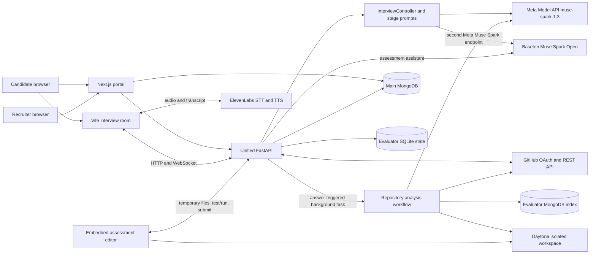
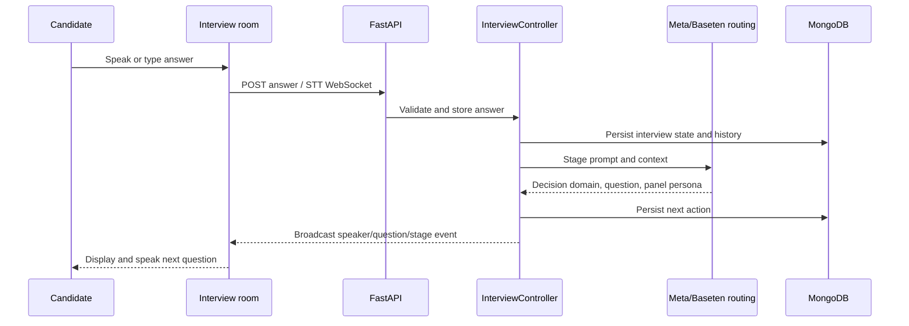
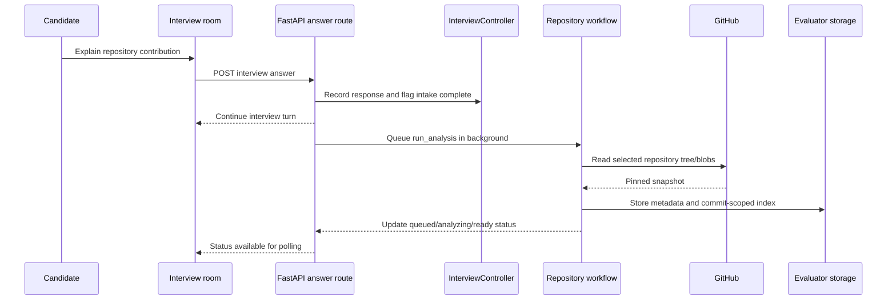
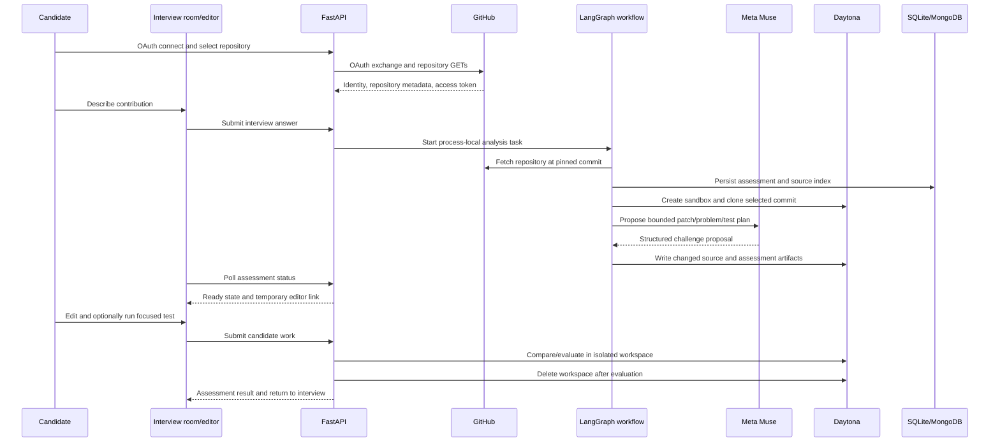

# Momentum System Architecture

## 1. High-level architecture

The Next.js portal handles recruiter/candidate workflows and connects to MongoDB for portal data. The Vite interview room handles the live panel, transcript, voice controls, drawing canvas, and interview typing pad, and communicates with the unified FastAPI application. The interview controller coordinates state and stages; GitHub, Meta/Baseten, ElevenLabs, MongoDB, SQLite, and Daytona are external or persistence services.

The panel consists of generated personas selected for turns by a prompt and a shared controller. It is not a set of independently running model services.

## 2. Interview flow

1. The client requests setup data and submits interview creation to FastAPI.
2. `InterviewController` prepares candidate context and a role-specific panel, then creates the opening action.
3. Stage functions build a prompt from role context, covered areas, history, latest answer, panel, and repository readiness.
4. The shared LLM client generates a structured action/question. The controller validates and dispatches the action, persists state, and broadcasts events.
5. Voice output is requested from ElevenLabs TTS; the WebSocket STT route relays candidate audio to ElevenLabs. Typed responses use the same answer endpoint.
6. NORMAL, EXTENDED, FINAL, and CONCLUSION transitions are owned by the controller and server-side timer, not by the model.

The five NORMAL-stage `CONTINUE` domains are `clarification`, `project`, `area`, `repo_assessment`, and `code`. `DRAW` and `CONCLUDE` are separate control outcomes; other stages constrain their own allowed domains.

## 3. Background repository analysis

After the first repository-intake answer, the interview answer handler starts the evaluator through FastAPI `BackgroundTasks`. The interview continues while `run_analysis` fetches the repository at a pinned commit, inventories and indexes source, and prepares a challenge. The controller exposes evaluator status so the normal-stage prompt can offer the repository assessment only after it becomes `READY`.

## 4. Agentic assessment architecture

The evaluator maps a candidate-provided description to an eligible source area, creates a temporary Daytona workspace, and asks Meta Muse to propose one small behavior regression. Local validation checks that the proposed patch is bounded and syntactically valid where Python parsing applies. The workflow writes the altered source, `problem.md`, and a locked focused test into the temporary checkout. A separate private oracle supports evaluation and is not served through the normal editor file endpoints.

The candidate edits the temporary checkout, may use the assessment assistant, optionally runs the test, and submits. Evaluation first checks correctness; only a correct result is compared to the reference structure. No candidate patch is pushed to GitHub.

## 5. Assessment execution paths

### Path A: locally runnable selected behavior

```mermaid
flowchart LR
    Repo[Selected repository] --> Snapshot[Pinned snapshot]
    Snapshot --> Sandbox[Daytona workspace]
    Sandbox --> Dependencies[Minimal dependency setup]
    Dependencies --> Patch[Validated bug injection]
    Patch --> Problem[problem.md and locked focused test]
    Problem --> Candidate[Candidate fix]
    Candidate --> Run[Optional test execution]
    Run --> Submit[Submission]
    Submit --> Eval[Verify against original repository reference, then compare approach]
    Eval --> Cleanup[Workspace cleanup]
```

The assessment workspace includes the dependencies and focused tests used to check the candidate's correction.

### Path B: reference-based verification

```mermaid
flowchart LR
    Repo[Selected repository] --> Snapshot[Pinned snapshot]
    Snapshot --> Sandbox[Daytona workspace]
    Sandbox --> Analysis[Code and behavior analysis]
    Analysis --> Patch[Validated bug injection]
    Patch --> Problem[problem.md and saved original reference]
    Problem --> Candidate[Candidate fix]
    Candidate --> Submit[Submission]
    Submit --> Eval[Verify against original repository reference]
    Eval --> Cleanup[Workspace cleanup]
```

## 6. Sequence diagram: GitHub-backed assessment

